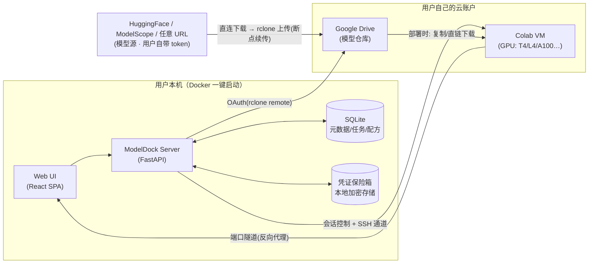

# ModelDock — 把 Colab 变成你的按需 GPU 工作台

**开源设计稿 v0.2**（2026-11-11 更新：新增聊天部署与 HF/魔搭双源）
状态：设计阶段，未开始编码
代号：ModelDock（暂定，可改）

---

## 1. 一句话定位

一个开源的、跑在用户自己电脑上的 Web 应用：连接你自己的 Google Drive 和 Colab 账户，把大模型囤在云盘，需要时一键部署到 Colab GPU，用完自动释放——不依赖任何第三方云服务，凭证不出本机。

**目标用户**
- 有 Colab Pro/免费额度、想跑大模型但本地显存/内存不够的个人开发者
- 使用 ComfyUI / 各类 GGUF/Weights 模型的 AI 玩家
- 想把"模型资产"（几十 GB 文件）长期存放在云盘、按需搬到算力上的人

**名场景（来自真实工作流）**
> 图生视频：本地 32GB Mac 跑 15 秒要 49 分钟；把 29GB 模型存到 Google Drive，在 Colab A100 上复制模型 + 生成只要几分钟，生成 96 秒。

> 聊天部署：Qwen3 GGUF 存云盘，需要时 3 分钟内在 Colab 起 llama.cpp（OpenAI 兼容 API），内置 Chat 页直接对话，聊完自动释放。

---

## 2. 核心用户故事

| # | 作为 | 我想要 | 为了 |
|---|---|---|---|
| U1 | 用户 | 用 Google 账户登录并授权 Drive + Colab | 让软件替我操作两边的资源 |
| U2 | 用户 | 从 HuggingFace/自定义 URL 添加模型任务，下载进云盘 | 云盘 = 模型仓库，换 Colab 会话也不用重下 |
| U3 | 用户 | 浏览云盘中的模型（大小/类型/校验） | 知道我囤了什么、是否完整 |
| U4 | 用户 | 一键把某组模型部署到 Colab（选 GPU 型号） | 免去手动开 VM、装环境、拷模型的繁琐流程 |
| U5 | 用户 | 在浏览器里直接使用部署好的服务（如 ComfyUI） | 不碰命令行 |
| U6 | 用户 | 用完自动/一键释放会话 | 不空烧 compute units |
| U7 | 用户 | 看到 Colab 余额（compute units）、Drive 剩余空间 | 心里有数 |
| U8 | 用户 | 从 HuggingFace / 魔搭社区（ModelScope）下载模型，可各自提供访问 token | 国内网络可用魔搭源加速；能拉取 gated/私有仓库 |
| U9 | 用户 | 一键部署聊天模型（llama.cpp / vLLM），并在内置 Chat 页直接对话 | 免搭环境免命令行，获得 OpenAI 兼容端点 |
| U10 | 进阶用户 | 定义自己的部署配方（启动脚本/工作流） | 不限于 ComfyUI 和聊天 |

---

## 3. 总体架构



### 关键设计原则（对应本会话实测教训）

1. **不依赖 `drive.mount`**。实测 Colab CLI 与网页端的 Drive 挂载均会出现 OAuth 兼容问题（`Invalid response_type` / `credential propagation unsuccessful`）。**设计上强制走 rclone 直连通道**（OAuth 授权 rclone remote，同一套配置既用于上传云盘，也用于 Colab→Drive 拉取模型）。
2. **Colab 凭证最小化注入**。部署时向 Colab 临时会话注入最小权限的 rclone 配置用于拉取模型，任务结束即随 VM 销毁；主凭证永远不出本机。
3. **会话即用即释**。所有部署绑定会话生命周期，提供自动释放策略（空闲超时/任务完成/手动）。
4. **本地优先，云中立**。软件本体不需要任何中间服务器；Colab 的操作走用户自己浏览器的已登录会话或 OAuth。

---

## 4. 功能模块

### 4.1 账户中心
- Google OAuth 登录（本地回环 redirect），授权范围：Drive 读写、Colab 会话
- Drive：总/剩余空间、目录约定（`/modeldock/models/<family>/<file>`）
- Colab：可用 GPU 类型、余额（compute units）、地区
- 连接体检：测试 rclone remote 可用性、Colab 会话创建探针

### 4.2 模型仓库（云盘侧）
- **模型源三通道**：
  - HuggingFace：repo id / 文件 glob；支持 gated 仓库（用户在站方自行申请后，提供 HF token + `Accept` 状态检测）
  - 魔搭社区 ModelScope：国内网络优先源，速度快、无需翻墙；支持 ModelScope SDK 直传
  - 自定义 URL / 本地文件上传
- **Token 管理**：HF token 与 ModelScope token 各自独立存储于凭证保险箱（最小权限：read-only），仅在下载器进程环境注入，不落任务日志；可随时吊销/轮换
- **下载引擎**：`huggingface_hub` / `modelscope` SDK / `aria2` / rclone；多线程分片 + 断点续传；双源互备（HF 失败自动切魔搭，逐文件校验 hash 一致）
- 入盘前校验（大小/哈希），入盘后登记元数据（类型识别：GGUF/safetensors/VAE/LoRA/文本编码器/对话模型等）
- 模型清单视图：分组（按用途：对话/图像/视频/音频）、搜索、重复检测（同模型不同量化，标注 Q4/Q8 等精度关系）
- 共享/清除：删除云盘文件 + 本地元数据级联

### 4.3 部署管线
- **配方（Recipe）** = 部署单元：所需模型集合 + 环境安装脚本 + 启动命令 + 服务端口
  - 内置配方：
    - 图像/视频：ComfyUI（含 GGUF/视频节点）、SD-WebUI …
    - **聊天**：llama.cpp Server（GGUF · OpenAI 兼容 /v1）、vLLM（A100 · HF safetensors 多并发）、Ollama（GGUF 私有 API）
  - 用户自定义配方：Git/llm 市集导入
- **部署步骤**（每一步可见、可重试、可取消）：
  1. 会话编排：请求 GPU 型号（A100 → L4 → T4 自动降级），创建会话
  2. 密钥注入：临时 rclone 凭证 → `/content/.secrets`
  3. 环境安装：配方 install 脚本（克隆/装依赖）
  4. 模型装配：Drive → Colab 本地复制（实测 29GB 约 5–15 分钟），或对直链模型边下边用
  5. 服务启动 + 健康检查
  6. 访问隧道：通过 SSH 隧道把 ComfyUI 等端口映射给浏览器
  7. 结束清理：删除临时凭证 → 释放会话
- 进度面板：复制速度/ETA、GPU/显存、耗时日志

### 4.4 Chat 面板（聊天部署的使用层）
- 就绪后在 Web UI 内直接对话：模型参数（temperature / top_p / max_tokens / system prompt / 上下文长度）
- 消息历史本地保存（按会话）；支持流式输出（通过隧道转发 SSE）
- 一键导出 OpenAI 兼容端点地址（供本机其它应用接入，如 Cherry Studio / OpenWebUI）
- 多模型快速切换：同一 Colab 会话可挂多个 GGUF（受显存限制提示）

### 4.5 会话与费用
- Dashboard：活动会话、历史会话（时长×GPU≈points 消耗估算）
- 自动释放策略：空闲 N 分钟 / 下载断流保护 / 定时释放
- 额度日志：余额快照对比（运行前/运行后）

### 4.6 设置
- 传输：并行度、限速（Upload 带宽保护）
- 存储：模型目录、临时中转目录、自动清理
- 安全：凭证加密口令（PGP 派生对称密钥 / OS keychain 集成）

---

## 5. 数据模型

```
UserAccount   id、name、 oauth_token(加密)、scopes、created_at
DriveRemote   id、account_id、rclone_config(加密)、quota_cache、mount_path
ModelEntry    id、family、用途类型(对话/图像/视频/音频)、provider(hf/modelscope/url)、license?、files[]、total_bytes、sha256?、source_url、added_at
ModelFile     id、model_id、drive_path、bytes、quant?、verified、updated_at
Recipe        id、名称、kind(built-in/custom)、kind_class(comfyui/chat/generic)、manifest(依赖模型 role 映射)、install、run、ports、icon、api_flavor(openai-compatible?)
Deployment    id、recipe_id、params、colab_gpu、session_id、状态机、progress、points_estimate、logs
Session       id、colab_metadata、created_at、released_at、gpu_type、peak_mem
ChatThread    id、deployment_id、messages[]、params、updated_at
AccessSecret  id、scope[google/hf/modelscope/colab]、vault(加密)、rotated_at
```

**部署状态机**：`queued → provision → install → syncing_models → booting → ready → idling → releasing → done`；任一步可 `failed/cancelled`，失败可从最近成功步恢复（重试不重复扣整段时间）。

---

## 6. 技术选型（初稿）

| 层 | 选择 | 理由 |
|---|---|---|
| 前端 | React + Vite + Tailwind + shadcn/ui | 轻量、组件丰富、易于实现进度类 UI |
| 后端 | Python FastAPI | rclone/hf 生态亲和；SSH/进程编排简单 |
| 任务队列 | Celery/ARQ (Redis) 或内置 asyncio 池 | MVP 用内置池，后续可拆 |
| 存储 | SQLite + 文件附件 | 单机零运维，用户可备份 |
| 传输通道 | rclone (binary 子进程) | 断点续传、限速、rclone copyurl 直传支持 |
| 模型下载 | `huggingface_hub`（HF token 注入 env）+ `modelscope` SDK（国内优先源）+ aria2 | 双源互备、gated 仓库支持 |
| Colab 控制 | 借鉴/封装 `colab-cli`（现成 API：new/run/ssh/stop）+ 浏览器控制通道备选 | 生态现成，减少重新踩坑 |
| 隧道 | Colab SSH + Node本地端口转发；window 上打开 localhost:PORT 即用 | 零三方依赖 |
| 打包 | Docker Compose（含 rclone、aria2、hf-cli 镜像合并）或 PaaS 模板 | 一键跑起来 |

---

## 7. 安全方案

- **凭证**：Google OAuth token / Drive rclone refresh_token / Colab token 存本地加密（用户口令或 OS keychain）；绝不上传、绝不写日志。
- **Colab 注入**：部署中给会话一个 **只读 Drive** 的临时 rclone 配置（或公开直链下载 URL），任务结束删除；不做全权 refresh_token 下发。
- **开源审计**：凭证路径加密、传输路径（rclone TLS）、日志脱敏均有单测。
- **合规**：模型下载记录来源（HF 许可标注），未授权模型来源可标记警告。

---

## 8. MVP 范围（建议 3 个迭代）

**v0.1 能用**（一次闭环）
- [ ] 账户连接（OAuth + Drive rclone）
- [ ] 模型下载：HF + ModelScope 双源、token 管理、断点续传+校验
- [ ] ComfyUI 内置配方（含 GGUF 视频/SDXL 模板，固定模型组合）
- [ ] **llama.cpp 聊天配方：GGUF 部署 + 内置 Chat 页 + OpenAI 兼容端点导出**
- [ ] Colab 会话 create→install→sync→run→tunnel→release 全自动 + UI 面板
- [ ] compute units 余额展示

**v0.2 好用**
- [ ] vLLM 聊天配方（A100 多并发）、多模型切换
- [ ] 多 GPU 型号预检/降级、空闲自动释放
- [ ] 模型家族管理、重复检测、配方可自定义
- [ ] 会话历史 × 费用估算

**v0.3 生态**
- [ ] 配方市集（社区分享 YAML）| 多账户 | 手机端 PWA | 释放锁屏提醒

---

## 9. 关键风险与已知坑（实测经验一览）

| 风险 | 影响 | 对策 |
|---|---|---|
| Colab 非公开 API 变动（colab-cli 依赖） | 部署失效 | 接口层抽象+版本化，备用手动 Notebook 导出方案（生成可粘贴代码单元） |
| Drive 挂载 OAuth bug | 模型装配失败 | 不走 drive.mount，强制 rclone 通道 |
| 单文件>15GB 云盘限制（非 Workspace） | 大模型上传失败 | 自动分卷 + Colab 侧重组；或提示使用直链下载 |
| compute units 消耗不透明 | 用户超支 | 会话前后余额快照+额度跟踪图表 |
| Colab 定时/滥用限制 | 会话被回收 | 断线自动检测+可恢复重部署，不影响已存云盘数据 |
| Colab 磁盘~200GB | 大工作流可能溢出 | 部署前配方→模型总体积硬校验 |
| 模型版权/内容安全 | 灾难 | 只做下载编排，不内置分发；明示来源路径 |
| HF gated 模型条款 | 账号违规 | 部署 gated 模型前检测用户已站方同意（API 401/403 引导），token 仅只读权限 |
| 魔搭镜像与 HF hash 不一致 | 模型损坏 | 双源切换时强制逐文件 sha256/etag 校验，不一致拒收 |
| 用户 token 泄漏 | 账号损失 | 只读 scope、保险箱加密、下载进程注入 env 而非命令行、日志脱敏 |
| Guest/共享使用 | 凭证泄漏 | 全部件强制绑定本机用户名，禁止 API 暴露到 0.0.0.0 |

---

## 10. 开源策略（建议）

- 协议：AGPL-3.0（防云厂商直接商用）或 Apache-2.0（更友好）——建议 **先听取社区意见**
- 目录划分建议：`web/`、`server/`、`recipes/`、`docs/`、`docker/`
- 文档优先（每个内置配方独立 README，降低开发门槛）

---

## 11. 下一步（任务清单，待用户确认后启动）

1. ✅ 设计稿评审 / 修改 / 冻结
2. 🔲 技术骨架脚手架（FastAPI + Vite + Docker Compose）
3. 🔲 Drive 通道.proto（OAuth→rclone config 生成）
4. 🔲 Colab 编排最小原型（create/ssh/stop）
5. 🔲 第一条完整部署管线（ComfyUI GGUF 视频）
6. 🔲 MVP UI 页面
